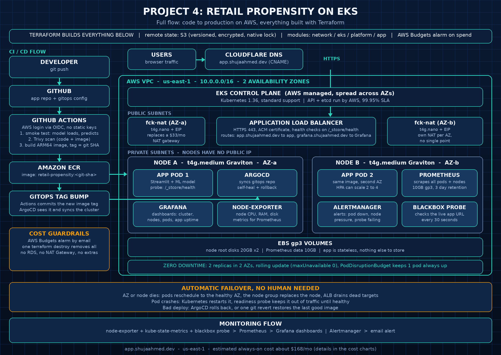
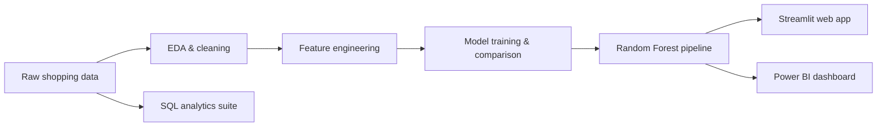
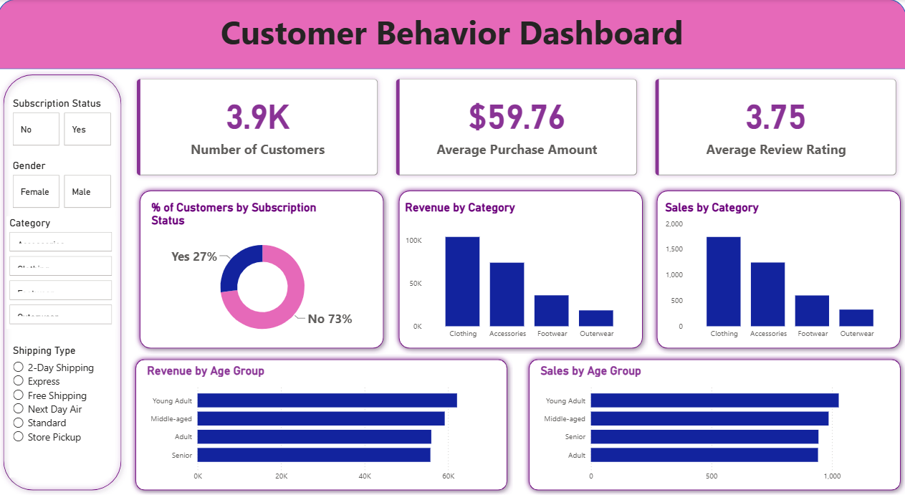

# ☁️ Deployment: this app runs in production on Amazon EKS

**Live app:** https://app.shujaahmed.dev
**Monitoring (Grafana):** https://grafana.shujaahmed.dev

This repo takes the Retail Subscription Propensity app (original project below) and runs it in production on AWS with a full DevOps pipeline. Everything is code: Terraform for the AWS side, Helm and Argo CD inside the cluster.



## How it is built

- **Terraform** creates the network and cluster: VPC 10.0.0.0/16 across two availability zones, public and private subnets, a low cost fck-nat pair instead of managed NAT gateways, and an Amazon EKS 1.36 cluster.
- **Nodes** are Spot t4g.medium (ARM) in a managed node group that scales from 2 to 4. A $150/month AWS budget alarm watches the spend.
- **CI** runs on GitHub Actions (native ARM runner). It assumes an AWS role with OIDC, so there are no static AWS keys anywhere. It builds the Docker image (the model is pinned to scikit-learn 1.7.2, the version it was trained with), pushes it to Amazon ECR, then commits the new image tag back into the Helm values.
- **Argo CD** watches this repo and syncs the app chart and the monitoring stack. Git is the source of truth, the cluster heals itself back to what the repo says.
- **One shared Application Load Balancer** serves the app and Grafana, with an ACM certificate for HTTPS and HTTP redirected to HTTPS.
- **Monitoring** is kube-prometheus-stack: Prometheus with 3 day retention on a 10 Gi gp3 volume, Grafana dashboards for node and pod views.

## Proof it works

- Health endpoint returns ok: https://app.shujaahmed.dev/_stcore/health
- Self healing drill: app pods were deleted on purpose and both replacements were running again in about 50 seconds.
- Zero downtime deploys: the chart rolls with maxUnavailable 0 and a pod disruption budget of 1.

## Repo layout (deployment parts)

```
├── terraform/              # Bootstrap, network, EKS and platform modules
├── helm/retail-propensity/ # The app Helm chart
├── gitops/                 # Argo CD Applications (app + monitoring) and the gp3 storage class
└── .github/workflows/      # CI: build, push to ECR, bump the image tag
```

The application itself is the open source project below (MIT), by raomiran14. This repo adds the production deployment around it.

---

# 🛍️ Retail Subscription Propensity — ML Prediction Engine

> End-to-end machine learning system predicting which retail customers are most likely to convert to a premium subscription — served as an interactive Streamlit app, with a Power BI executive dashboard and a SQL analytics suite.

[](https://www.python.org/)
[](https://streamlit.io/)
[](https://scikit-learn.org/)
[](LICENSE)

**🌐 Live demo:** https://retail-subscription-propensity.streamlit.app

---

## The Problem

Retailers bleed margin on blanket discounts. This project scores every customer on **subscription propensity** so marketing teams can target incentives at high-propensity shoppers instead of discounting everyone.

## The Solution

A complete ML pipeline — from raw shopping-behavior data to a deployed prediction app:



## Model Performance

| Model | Accuracy | Precision | Recall | F1-Score | ROC-AUC |
|---|---|---|---|---|---|
| Logistic Regression | 0.865 | 0.668 | 1.000 | 0.801 | 0.909 |
| **Random Forest ✅** | 0.853 | 0.671 | 0.891 | 0.766 | **0.912** |

**Random Forest selected.** Note the Logistic Regression trap: its perfect recall (1.000) comes from over-predicting the positive class — accuracy alone is misleading on imbalanced targets, so the model is judged on ROC-AUC and the precision/recall balance instead.

## App Features

- 🎯 **Probability scorecard** — subscription conversion probability with high/low propensity badges
- 👤 **Guardrailed inputs** — 22 known products and all 50 US states as dropdowns (no free-text, so no unseen-category leakage at inference time)
- ⚡ **Scenario presets** — one-click customer profiles for instant evaluation
- 📊 **Power BI dashboard** — executive view of customer behavior (`dashboard/`)
- 🗄️ **SQL analytics suite** — 8+ business queries: revenue by segment, discount analysis, loyalty tiers (`sql/`)

## Tech Stack

Python · scikit-learn · pandas · Streamlit · Power BI · SQL (MySQL via SQLAlchemy) · joblib

## Project Structure

```
├── app.py                  # Streamlit prediction app
├── db.py                   # Database persistence layer
├── models/                 # Serialized sklearn pipeline (.pkl)
├── notebooks/              # EDA + feature engineering notebooks
├── dashboard/              # Power BI dashboard (.pbix + preview)
├── sql/                    # Business analytics queries
└── requirements.txt
```

## Quickstart

```bash
git clone https://github.com/raomiran14/retail-subscription-propensity.git
cd retail-subscription-propensity
pip install -r requirements.txt
streamlit run app.py
```

## Dashboard Preview



## What's Next

- [ ] Probability calibration for the scorecard
- [ ] XGBoost / LightGBM comparison
- [ ] Threshold tuning via precision-recall analysis

## License

MIT — see [LICENSE](LICENSE).
